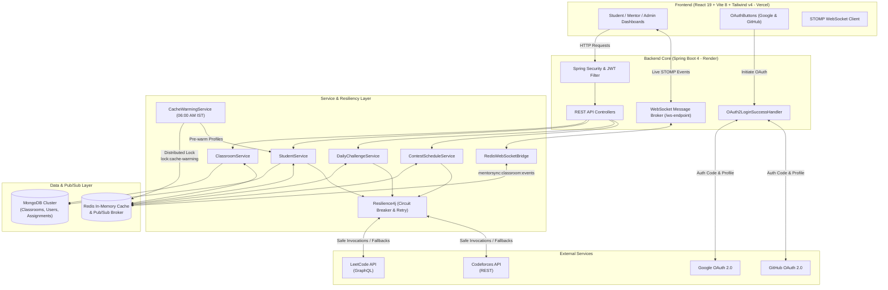

# MentorSync — LeetCode & Codeforces LMS

<div align="center">

[](https://mentorssync.vercel.app/)
[](https://leettracker-backend-nq7r.onrender.com)


**An enterprise-grade Learning Management System bridging educators, mentors, and students with automated coding assignment verification, dual-platform competitive programming telemetry (LeetCode & Codeforces), OAuth 2.0 social authentication, and real-time clustered leaderboards.**

[Live Web App](https://mentorssync.vercel.app/) • [Feature Highlights](#feature-highlights) • [System Architecture](#system-architecture) • [OAuth 2.0 Setup](#oauth-20-setup--production-deployment) • [Local Quickstart](#quickstart--local-setup) • [API Reference](#api-endpoints-reference)

</div>

---

## 🌐 Live Deployments

| Component | Platform | URL | Status |
| :--- | :--- | :--- | :--- |
| **Frontend Web Application** | Vercel | [https://mentorssync.vercel.app/](https://mentorssync.vercel.app/) |  |
| **Backend REST & WebSocket API** | Render | [https://leettracker-backend-nq7r.onrender.com](https://leettracker-backend-nq7r.onrender.com) |  |

---

## Overview

**MentorSync** eliminates manual grading and administrative friction for coding bootcamps, university computer science departments, and competitive programming clubs. By integrating directly with **LeetCode** (GraphQL API) and **Codeforces** (REST API), MentorSync continuously tracks problem solutions, contest rating progressions, and assignment deadlines.

Mentors can create virtual classrooms, enroll students individually or in bulk via CSV, assign curated problems with strict time windows, and monitor progress on a live real-time leaderboard. Students enjoy a unified competitive programming profile, automated one-click assignment verification, and peer accountability through daily challenge tickers.

---

## Feature Highlights

### 🔑 OAuth 2.0 Social Authentication (Google & GitHub)
* **One-Click Sign-In**: Frictionless authentication with Google and GitHub accounts.
* **Intelligent Account Linking**: Automatically links to existing Student or Mentor profiles based on verified email, preserving roles and permissions.
* **Auto-Registration & Onboarding**: First-time social logins are automatically registered as Students, with a guided dashboard prompt to link their LeetCode and Codeforces usernames.
* **Cross-Site Security**: Issues short-lived cryptographic JWT access tokens alongside rotating `HttpOnly` refresh token cookies (`SameSite=None`, `Secure=true`) supporting cross-domain setups between Vercel and Render.
* **Reverse Proxy SSL Forwarding**: Uses `server.forward-headers-strategy=framework` to seamlessly handle cloud load balancer SSL termination, preventing OAuth redirect URI mismatches.

### ⚡ Official LeetCode Problem of the Day (POTD)
* **Live Daily Challenge**: Directly pulls the official daily challenge from LeetCode (`activeDailyCodingChallengeQuestion`) with topic tags, difficulty pills, problem hint, and direct solve links.
* **Global Redis Caching (`global-potd`)**: Cached globally under `global-potd::today` with automatic date-staleness validation. Because the problem of the day is 100% identical for every user, it is stored once globally in Redis and shared across all students and mentors, eliminating redundant upstream calls.
* **Collaborative Classroom Ticker**: Surfaces a live classroom participation banner:  
  `"14 of 24 students in your classroom have solved today's POTD!"` — motivating peer accountability and daily problem-solving consistency.

### 🏆 Live Upcoming Contests Tracker
* **Dual-Platform Schedule**: Aggregates upcoming contest schedules from both **LeetCode** (Weekly & Biweekly) and **Codeforces** (Div 1/2/3/4).
* **Global Redis Caching (`upcoming-contests`)**: Cached globally under `upcoming-contests` (`ALL`, `LEETCODE`, `CODEFORCES`) with a 30-minute TTL.
* **404 Prevention Filter**: Automatically restricts LeetCode contests strictly to active, published upcoming events.
* **Direct Registration Links**: Generates one-click registration redirects (`https://codeforces.com/contestRegistration/{id}`) for upcoming Codeforces contests.
* **Interactive UI**: Real-time countdown clocks, duration badges, and instant platform filtering.

### 🔄 Redis Cache Warming Worker & Distributed Lock
* **Zero Cold-Cache Lag**: Background scheduled worker runs daily at **6:00 AM Indian Standard Time (IST)** (`@Scheduled(cron = "0 0 6 * * ?", zone = "Asia/Kolkata")`) to prime global caches (`global-potd`, `upcoming-contests`) and pre-warm student statistics (`student-progress`, `student-stats`, `student-recent`, `student-profile`).
* **Atomic Distributed Locking**: Acquires a Redis lock (`lock:cache-warming`, 30 min TTL) via `setIfAbsent()` to guarantee only one node warms the cache in multi-instance or clustered deployments.
* **Admin On-Demand Trigger**: Secure administrative endpoint (`POST /api/admin/cache/warm`) allows instant cache re-warming at any time.

### 📡 Real-Time Clustered WebSockets
* **STOMP over WebSocket**: Connected clients receive instant updates over `/topic/classrooms/{classroomId}` without needing manual page reloads.
* **Redis Pub/Sub Cluster Bridge**: The `RedisWebSocketBridge` publishes events to `mentorsync:classroom:events`. Clustered server instances synchronize state seamlessly, dispatching local WebSocket notifications to connected students and mentors.

### 🛡️ Enterprise Resilience & Fault Tolerance
* **Resilience4j Circuit Breaker**: Tracks upstream LeetCode API error rates. If failures exceed 50%, the circuit opens to prevent cascading timeouts, immediately serving cached Redis data.
* **Exponential Backoff Retry**: Automatically retries transient failures up to 3 times with progressive delays (2s, 4s).
* **Rate Limiting**: Throttles calls to 15 requests per 10 seconds to safeguard your server IP against third-party API throttling.

### 🏫 Classroom & Assignment Management
* **Auto-Fetch Problem Titles**: Mentors paste a LeetCode problem URL — MentorSync automatically extracts the title slug, queries the API, and auto-populates the assignment title and difficulty.
* **Automated Verification**: Students validate homework with one click (`auto-validate`); MentorSync queries LeetCode's recent submissions to verify problem acceptance and timestamps.
* **Student Nudge System**: Mentors can trigger automated email reminders to students with overdue or pending assignments.
* **CSV Bulk Import & Export**: One-click bulk student onboarding via CSV and instant export of classroom performance metrics.

### 📈 Comprehensive Telemetry & Analytics
* **Consistency Heatmap**: Full interactive GitHub-style calendar heatmap displaying daily coding submissions.
* **Multi-Metric Leaderboard**: Sort student rankings dynamically by **Streak**, **Total Solved**, **Contest Rating**, or **Pending Assignments**.
* **Unified Contest History**: Synchronized graph displaying LeetCode and Codeforces historical rating curves and global ranks.

### 📞 Contact & Support Portal
* **Integrated Contact Page**: Real-time validated contact form with quick topic suggestions.
* **Direct Contact Details**: Support email (`varunkushwah31@gmail.com`), phone (`8218568519`), and headquarters (`KIET, Ghaziabad, India`).

---

## System Architecture



---

## Tech Stack

### Backend
* **Language & Runtime**: Java 21 LTS (Oracle OpenJDK)
* **Framework**: Spring Boot 4.0.5
* **Security & Auth**: Spring Security 6, Spring OAuth2 Client, JJWT (JSON Web Token)
* **Persistence**: Spring Data MongoDB, MongoDB 6.0+
* **Caching & Message Broker**: Redis 7.0+, Spring Data Redis, Jedis
* **Resiliency**: Resilience4j 2.2 (CircuitBreaker, Retry, RateLimiter)
* **Real-time Messaging**: Spring WebSocket, STOMP
* **Build & Testing**: Maven, JUnit 5, Mockito (139 unit & integration tests)

### Frontend
* **UI Framework**: React 19.2.4, TypeScript 5.9.3
* **Build Tooling**: Vite 8.3.1 (SWC)
* **Styling**: Tailwind CSS v4.2.2, Radix UI Primitives, Phosphor Icons
* **Real-Time Client**: `@stomp/stompjs` 7.3.0
* **Networking**: Axios with automatic JWT refresh and cross-site cookie support
* **Testing**: Vitest 5.0.3, React Testing Library (99 tests across 19 suites)

### Infrastructure & Deployment
* **Frontend Host**: Vercel (`https://mentorssync.vercel.app/`)
* **Backend Host**: Render (`https://leettracker-backend-nq7r.onrender.com`)
* **Containerization**: Docker, Docker Compose

---

## OAuth 2.0 Setup & Production Deployment

### 1. Google Cloud Console
1. Go to [Google Cloud Console Credentials](https://console.cloud.google.com/apis/credentials).
2. Create/edit an **OAuth 2.0 Client ID (Web Application)**.
3. **Authorized JavaScript origins**:
   ```
   https://mentorssync.vercel.app
   https://leettracker-backend-nq7r.onrender.com
   http://localhost:5173
   ```
4. **Authorized redirect URIs**:
   ```
   https://leettracker-backend-nq7r.onrender.com/login/oauth2/code/google
   http://localhost:8080/login/oauth2/code/google
   ```

### 2. GitHub Developer Settings
1. Go to [GitHub Developer Settings > OAuth Apps](https://github.com/settings/developers).
2. Create/edit your OAuth application:
   - **Homepage URL**: `https://mentorssync.vercel.app`
   - **Authorization callback URL**:
     ```
     https://leettracker-backend-nq7r.onrender.com/login/oauth2/code/github
     ```

### 3. Production Environment Variables

#### Render Backend Configuration
| Variable | Value | Purpose |
|---|---|---|
| `APP_OAUTH2_REDIRECT_URI` | `https://mentorssync.vercel.app/oauth2/redirect` | Post-login redirect to frontend |
| `CORS_ALLOWED_ORIGINS` | `https://mentorssync.vercel.app,http://localhost:5173,http://localhost:3000` | Cross-origin access permissions |
| `COOKIE_SECURE` | `true` | Secure HTTPS cookie flag |
| `COOKIE_SAME_SITE` | `None` | Cross-site cookie transmission between domains |
| `SERVER_FORWARD_HEADERS_STRATEGY` | `framework` | Reverse-proxy SSL header detection |
| `GOOGLE_CLIENT_ID` | `<your-google-client-id>` | Google OAuth ID |
| `GOOGLE_CLIENT_SECRET` | `<your-google-client-secret>` | Google OAuth Secret |
| `GITHUB_CLIENT_ID` | `<your-github-client-id>` | GitHub OAuth ID |
| `GITHUB_CLIENT_SECRET` | `<your-github-client-secret>` | GitHub OAuth Secret |
| `JWT_SECRET` | `<256-bit-hex-secret>` | Access token signature key |
| `MONGO_URI` | `mongodb+srv://...` | MongoDB cluster connection |
| `REDIS_HOST` | `<redis-host>` | Redis caching instance |

#### Vercel Frontend Configuration
| Variable | Value | Purpose |
|---|---|---|
| `VITE_API_BASE_URL` | `https://leettracker-backend-nq7r.onrender.com/api` | Backend API base path |
| `VITE_OAUTH_BASE_URL` | `https://leettracker-backend-nq7r.onrender.com` | OAuth initiation origin |

---

## Quickstart & Local Setup

### Option 1: Docker Compose (Full Stack)

Launch the entire stack (MongoDB, Redis, Backend, Frontend) with a single command:

```bash
# Clone the repository
git clone https://github.com/varunkushwah31/Leetcode-Tracker-Frontend.git
cd Leetcode-Tracker-Frontend

# Launch all microservices
docker compose up -d --build
```

Access the local services:
* **Frontend Application**: `http://localhost:5173`
* **Backend REST API**: `http://localhost:8080/api`
* **MongoDB**: `localhost:27017`
* **Redis**: `localhost:6379`

---

### Option 2: Manual Local Setup

#### Prerequisites
* **Java Development Kit (JDK) 21** or higher
* **Node.js (v18+)** and **npm**
* **MongoDB** (running on port 27017)
* **Redis** (running on port 6379)

#### 1. Backend Setup

```bash
cd Backend

# Copy example environment variables
cp .env.example .env

# Run all 139 unit tests
./mvnw clean test

# Start the Spring Boot application
./mvnw spring-boot:run
```

The backend server starts on `http://localhost:8080`.

#### 2. Frontend Setup

```bash
cd Frontend

# Install dependencies
npm install

# Run 99 Vitest tests across 19 suites
npm test

# Build production bundle
npm run build

# Start the Vite development server
npm run dev
```

Open `http://localhost:5173` in your browser.

---

## API Endpoints Reference

### Authentication & Social OAuth (`/api/v1/auth` & `/oauth2`)
* `GET /oauth2/authorization/google` — Initiate Google OAuth 2.0 handshake.
* `GET /oauth2/authorization/github` — Initiate GitHub OAuth 2.0 handshake.
* `POST /api/v1/auth/login` — Sign in with email & password, issues JWT and sets refresh cookie.
* `POST /api/v1/auth/register` — Register a mentor account.
* `POST /api/v1/auth/register/student` — Register a student with coding handles.
* `POST /api/v1/auth/register/student/send-otp` — Request 6-digit registration OTP.
* `POST /api/v1/auth/refresh` — Rotate access token via `HttpOnly` refresh cookie.
* `POST /api/v1/auth/logout` — Revoke session, blacklist token in Redis, clear cookies.
* `POST /api/v1/auth/change-password` — Change password (supports setting initial password for OAuth users).
* `POST /api/v1/auth/forgot-password` — Send password reset OTP.
* `POST /api/v1/auth/verify-otp` — Verify reset OTP.
* `POST /api/v1/auth/reset-password` — Finalize password reset.

### Challenges & Contests
* `GET /api/challenges/daily?classroomId={id}` — Retrieve today's LeetCode POTD with student solved status & classroom progress.
* `GET /api/challenges/daily/global` — Retrieve globally cached LeetCode POTD (0ms latency).
* `GET /api/contests/upcoming?platform={ALL|LEETCODE|CODEFORCES}` — Retrieve upcoming contests with countdowns and registration links.

### Classrooms (`/api/classrooms`)
* `POST /api/classrooms` — Create classroom (`mentorId`, `className`).
* `GET /api/classrooms/{id}/dashboard` — Fetch full classroom dashboard details.
* `POST /api/classrooms/{id}/students` — Add student to classroom.
* `DELETE /api/classrooms/{id}/students/{studentId}` — Remove student from classroom.
* `POST /api/classrooms/{id}/students/bulk` — Upload CSV to bulk-enroll students.
* `POST /api/classrooms/{id}/assignments` — Create assignment (auto-fetches problem title from URL).
* `PUT /api/classrooms/{id}/assignments/{assignmentId}/deadline` — Update assignment deadline.
* `DELETE /api/classrooms/{id}/assignments/{assignmentId}` — Remove an assignment.
* `GET /api/classrooms/{id}/leaderboard` — Get classroom real-time leaderboard.
* `GET /api/classrooms/{id}/export` — Export classroom student performance to CSV.
* `POST /api/classrooms/{id}/students/{studentId}/nudge` — Dispatch email reminder for pending tasks.

### Students (`/api/students`)
* `GET /api/students/me/dashboard` — Fetch student dashboard, heatmap, and assignments.
* `POST /api/students/me/sync` — Force profile re-sync with LeetCode & Codeforces.
* `PUT /api/students/me/handles` — Update competitive programming handles (LeetCode & Codeforces).
* `POST /api/students/me/classrooms/{cId}/assignments/{aId}/auto-validate` — Verify completion directly with LeetCode API.
* `POST /api/students/me/classrooms/{cId}/assignments/{aId}/validate` — Verify submission with submission URL.
* `GET /api/students/me/report` — Export personal progress report to CSV.

### Administration & Cache (`/api/admin`)
* `GET /api/admin/overview` — System health, total counts, and user metrics.
* `POST /api/admin/sync-all` — Force-sync all students across external platforms.
* `GET /api/admin/cache/stats` — Inspect Redis cache hit/miss stats and key metrics.
* `POST /api/admin/cache/clear?cacheName={name}` — Invalidate specific cache or flush all.
* `POST /api/admin/cache/warm` — Manually trigger background Cache Warming Worker.

### Contact & Support (`/api/v1/contact`)
* `POST /api/v1/contact` — Submit support inquiry or feedback.

---

## Testing & Quality Assurance

Both frontend and backend include automated test suites:

```bash
# Backend: 139 tests (JUnit 5 + Mockito)
cd Backend
./mvnw clean test

# Frontend: 99 tests across 19 suites (Vitest + React Testing Library)
cd ../Frontend
npm test
```

---

## Contact & Support

* **Email**: [varunkushwah31@gmail.com](mailto:varunkushwah31@gmail.com)
* **Phone**: +91 8218568519
* **Headquarters**: KIET, Ghaziabad, Uttar Pradesh, India
* **Web Portal**: [https://mentorssync.vercel.app/contact](https://mentorssync.vercel.app/contact)

---

## License

This project is licensed under the MIT License — see the [LICENSE](LICENSE) file for details.
